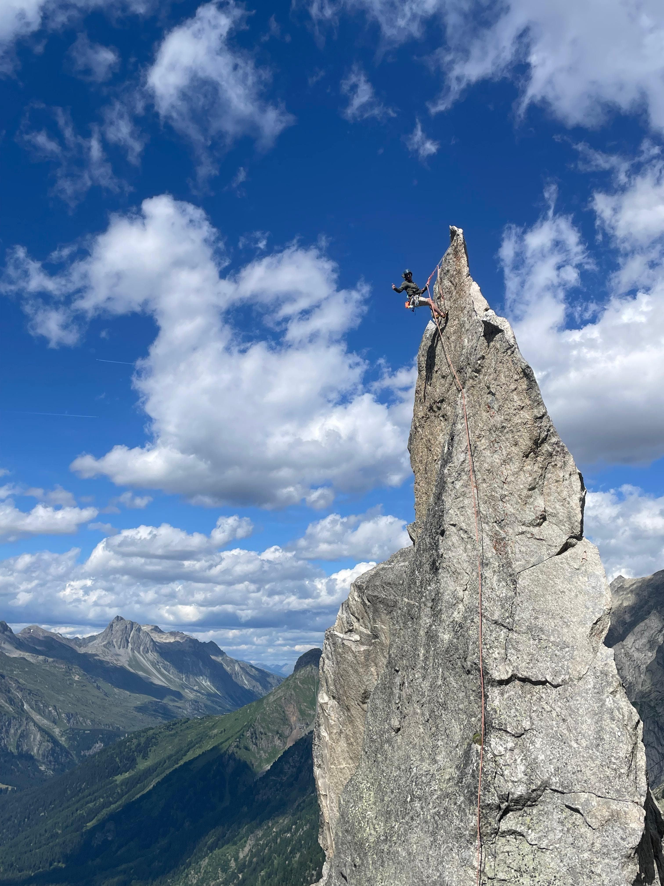
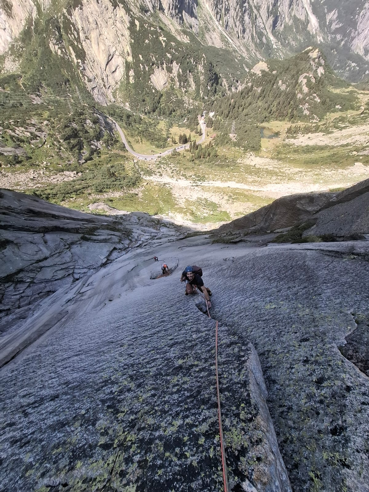
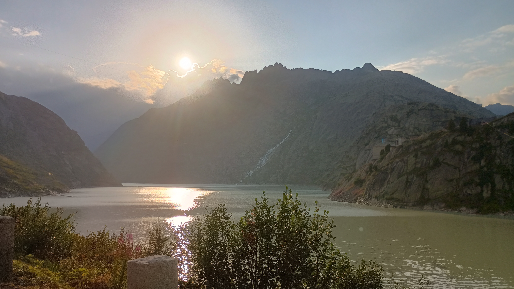
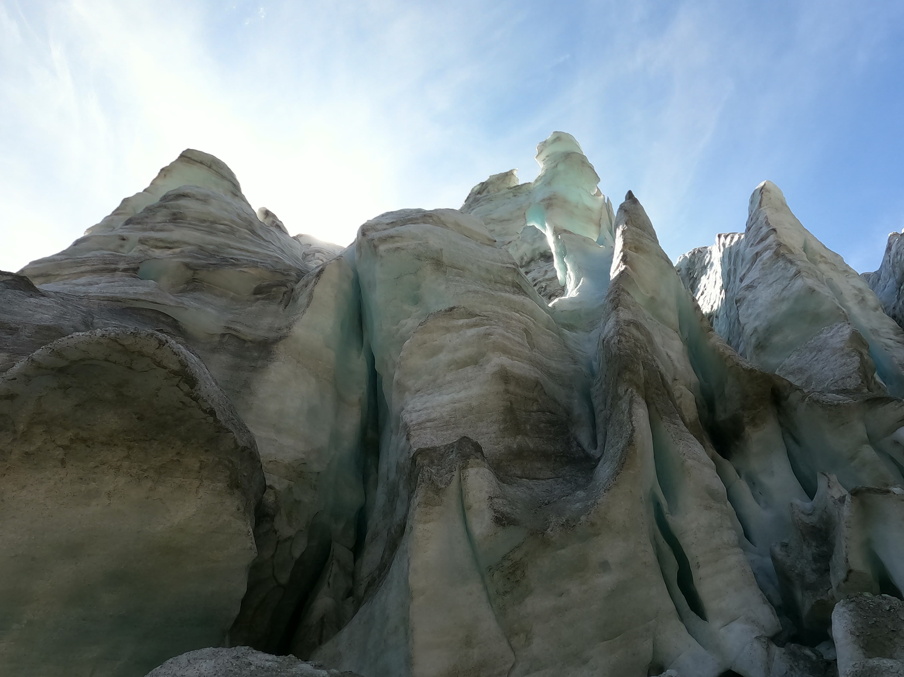

I am a Ph.D. researcher at **IDSIA USI–SUPSI** in Lugano, Switzerland, where I work on **Generative AI for Robotic Systems**.

My research focuses on **generative control**: steering pretrained generative models toward new goals and constraints, and understanding when their outputs can support reliable decisions. I connect local inverse geometry, safe action selection, and policy-conditioned viability with reinforcement learning and robotics.

My background is in automation, control, machine learning, and robotics. I received my M.Sc. and B.Sc. degrees in Automation Engineering from **Politecnico di Milano**. During my M.Sc., I was a visiting researcher at **IRIDIA, Université Libre de Bruxelles**, where I worked on SLAM for swarms of robots.

## Beyond Research

I come from **Valtellina**, a valley in the Italian Alps.

I am passionate about **alpinism and climbing**, and I spend much of my free time in the mountains. I particularly enjoy rock climbing and mountaineering.

::: {.mountain-gallery}

::: {.gallery-item}
[{.gallery-img}](images/alpinism-1.jpeg){.lightbox gallery="alpinism"}

Punta Albigna, Switzerland

:::

::: {.gallery-item}
[{.gallery-img}](images/alpinism-2.jpeg){.lightbox gallery="alpinism"}

Grimsel Pass, Switzerland

:::

::: {.gallery-item}
[{.gallery-img}](images/alpinism-3.jpeg){.lightbox gallery="alpinism"}

Grimsel Pass, Switzerland

:::

::: {.gallery-item}
[{.gallery-img}](images/alpinism-4.jpeg){.lightbox gallery="alpinism"}

Val Ferret, Italy

:::

:::

## Contact

**Angelo Moroncelli**  
Lugano, Switzerland

[angelo.moroncelli@supsi.ch](mailto:angelo.moroncelli@supsi.ch)

[GitHub](https://github.com/clmoro) · [Google Scholar](https://scholar.google.com/citations?user=3u1DpR4AAAAJ)