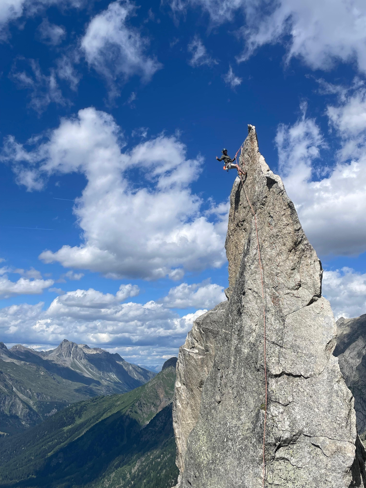
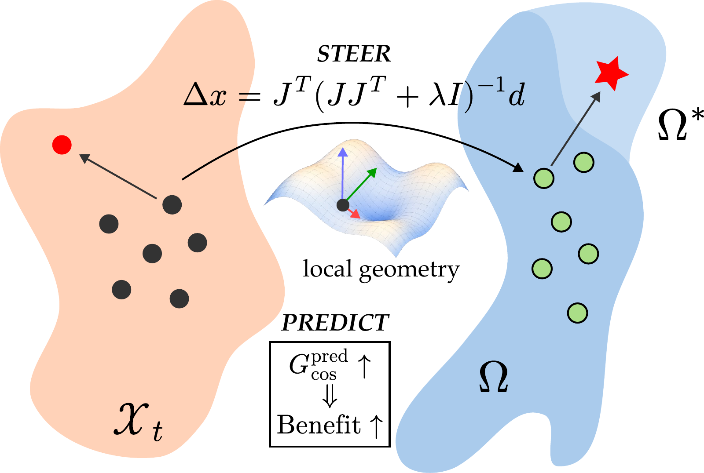
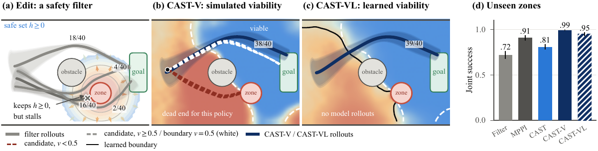
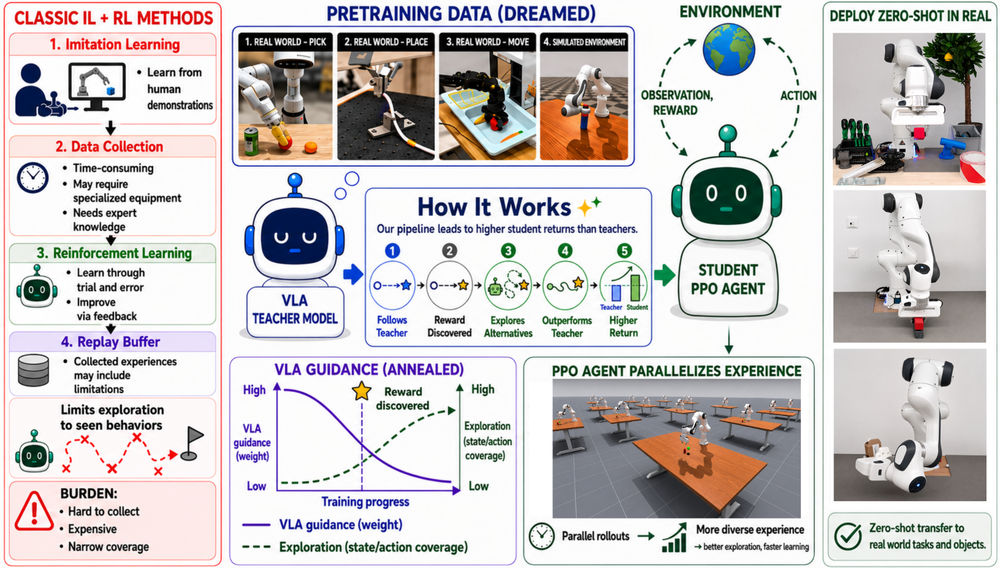
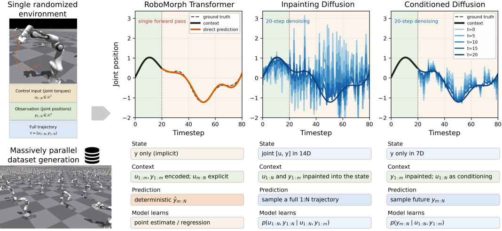
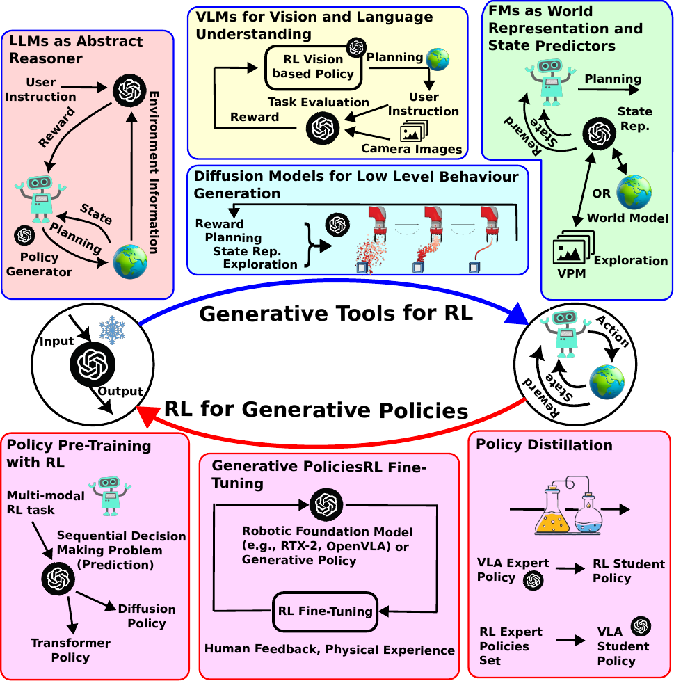

::: {.hero}
::: {.hero-photo .hero-photo-left}
{fig-alt="Angelo Moroncelli working with a robot in the IDSIA robotics lab"}
:::

::: {.hero-text}
# Angelo Moroncelli

**Ph.D. Researcher — Generative Control & Robot Learning**

IDSIA USI–SUPSI · Lugano, Switzerland

I study **generative control**: how pretrained generative models can meet new goals and constraints at deployment. My work connects **generative modeling, control, optimization, and reinforcement learning**, with robotics as a central application.

My recent research asks how to **steer frozen diffusion generators** through their local geometry, and how to **select safe, useful actions from generative policies while preserving their future ability to act**. More broadly, I investigate how generative priors can support adaptation, exploration, and learning beyond demonstrations.

[Google Scholar](https://scholar.google.com/citations?user=3u1DpR4AAAAJ){.btn .btn-primary}
[GitHub](https://github.com/clmoro){.btn .btn-outline-primary}
[Email](mailto:angelo.moroncelli@supsi.ch){.btn .btn-outline-primary}
[Download CV](files/cv.pdf){.btn .btn-outline-primary}
:::

::: {.hero-photo .hero-photo-right}
{fig-alt="Angelo Moroncelli climbing at Punta Albigna, Switzerland"}
:::
:::

## Selected Research

::: {.paper-grid}

::: {.paper-card}
{.paper-image fig-alt="Spectral Steering uses local inverse geometry to map an output request into a correction of a frozen diffusion generator"}

::: {.paper-card-body}
### Spectral Steering: Local Inverse Geometry for Frozen Diffusion Generators

**Under review**

Using request-dependent local geometry to steer frozen diffusion models toward new objectives while preserving other output properties.

[arXiv](https://arxiv.org/abs/2611.19572){.paper-link}
:::
:::

::: {.paper-card}
{.paper-image fig-alt="CAST-V and CAST-VL select viable routes around a new keep-out zone where a safety filter stalls"}

::: {.paper-card-body}
### Certify, Then Select: Viability-Aware Runtime Steering of Frozen Diffusion Policies

**Under review**

Certifying and ranking a frozen policy's own actions to satisfy new constraints, complete the task, and retain safe continuations.

[arXiv](https://arxiv.org/abs/2611.19047){.paper-link} · [Project & video](https://clmoro.github.io/cast/){.paper-link}
:::
:::

::: {.paper-card}
{.paper-image fig-alt="Overview of VLA jump-starting for reinforcement learning robotic agents"}

::: {.paper-card-body}
### Vision-Language-Action Jump-Starting for Reinforcement Learning Robotic Agents

**IEEE ICRA 2026 Workshop on RL4IL**

Using VLA priors to jump-start reinforcement-learning agents for robotic control.

[arXiv](https://arxiv.org/abs/2604.13733){.paper-link}
:::
:::

::: {.paper-card}
{.paper-image fig-alt="Comparison of RoboMorph Transformer and diffusion sequence models"}

::: {.paper-card-body}
### Diffusion Sequence Models for Generative In-Context Meta-Learning of Robot Dynamics

**IEEE CDC 2026**

Generative sequence modeling for in-context adaptation and learning of robot dynamics.

[arXiv](https://arxiv.org/abs/2604.13366){.paper-link}
:::
:::

::: {.paper-card}
{.paper-image fig-alt="SynthLA framework for synthetic language-action policies and closed-loop robot control"}

::: {.paper-card-body}
### SynthLA

**IEEE/RSJ IROS 2026**

Synthetic language-action policies for zero-shot real-world manipulation through structured perception.

[Publications](publications.qmd){.paper-link}
:::
:::

::: {.paper-card}
{.paper-image fig-alt="Overview of the duality between generative AI and reinforcement learning in robotics"}

::: {.paper-card-body}
### The Duality of Generative AI and Reinforcement Learning in Robotics

**Information Fusion, 2025**

A review of how generative AI and reinforcement learning complement each other in robotic systems.

[Publications](publications.qmd){.paper-link}
:::
:::

:::

[View all publications →](publications.qmd){.all-pubs}

## Research Interests

::: {.interest-grid}
::: {.interest-card}
**Generative Control**

Turning pretrained generative models into controllers that meet new goals and constraints at run time.
:::

::: {.interest-card}
**Geometry of Steering**

Local inverse geometry, controllability, and structured edits of frozen diffusion generators.
:::

::: {.interest-card}
**Safety & Viability**

Certified action selection and preserving a generative policy's future safe control authority.
:::

::: {.interest-card}
**Learning Beyond Imitation**

Generative priors, reinforcement learning, and adaptation for robot manipulation and embodied decision-making.
:::
:::

## Current Position

I am a Ph.D. researcher at **IDSIA USI–SUPSI** in Lugano, Switzerland, where I work on **Generative AI for Robotic Systems**.  

I am supervised by **Prof. Loris Roveda**, with **Prof. Alessandro Giusti** and **Prof. Luca Gambardella** as advisors.
