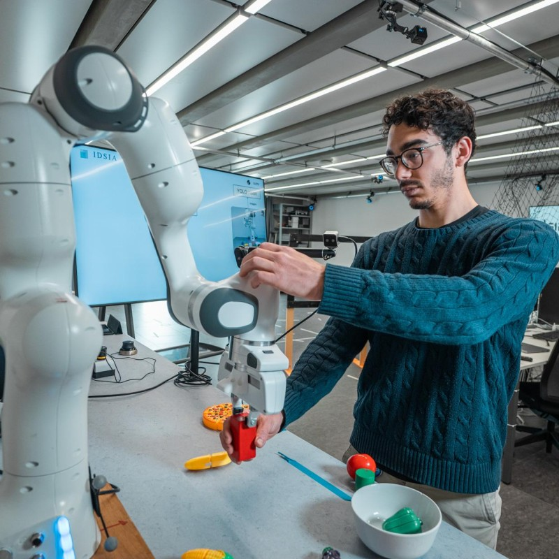
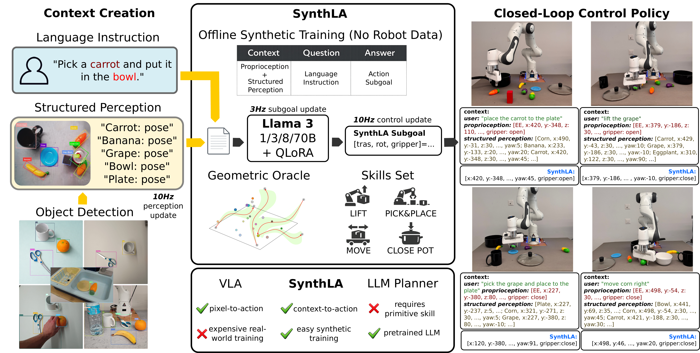

::: {.hero}
::: {.hero-photo}
{fig-alt="Angelo Moroncelli working with a robot in the IDSIA robotics lab"}
:::

::: {.hero-text}
# Angelo Moroncelli

**Ph.D. Researcher — Generative AI for Robotics**

IDSIA USI–SUPSI · Lugano, Switzerland

I work at the intersection of **generative modeling, reinforcement learning, and robotics**. My research investigates how **generative optimization** can enable robotic agents to move beyond the imitation of skills learned from labeled demonstrations. I initially explored the **out-of-distribution behavior of generative policies**, investigating how they behave beyond their training distribution. More recently, I have been studying how **generative priors, such as diffusion and flow-based policies and vision-language-action models, can be integrated with reinforcement learning** to guide exploration and optimize behavior beyond the training data.

[Google Scholar](https://scholar.google.com/citations?user=3u1DpR4AAAAJ){.btn .btn-primary}
[GitHub](https://github.com/clmoro){.btn .btn-outline-primary}
[Email](mailto:angelo.moroncelli@supsi.ch){.btn .btn-outline-primary}
[Download CV](files/cv.pdf){.btn .btn-outline-primary}
:::
:::

## Selected Research

::: {.paper-grid}

::: {.paper-card}
{.paper-image fig-alt="Overview of VLA jump-starting for reinforcement learning robotic agents"}

::: {.paper-card-body}
### Vision-Language-Action Jump-Starting for Reinforcement Learning Robotic Agents

**IEEE ICRA 2026 Workshop on RL4IL**

Using VLA priors to jump-start reinforcement-learning agents for robotic control.

[arXiv](https://arxiv.org/abs/2604.13733){.paper-link}
:::
:::

::: {.paper-card}
{.paper-image fig-alt="Comparison of RoboMorph Transformer and diffusion sequence models"}

::: {.paper-card-body}
### Diffusion Sequence Models for Generative In-Context Meta-Learning of Robot Dynamics

**IEEE CDC 2026**

Generative sequence modeling for in-context adaptation and learning of robot dynamics.

[arXiv](https://arxiv.org/abs/2604.13366){.paper-link}
:::
:::

::: {.paper-card}
{.paper-image fig-alt="SynthLA framework for synthetic language-action policies and closed-loop robot control"}

::: {.paper-card-body}
### SynthLA

**IEEE/RSJ IROS 2026**

Synthetic language-action policies for zero-shot real-world manipulation through structured perception.

[Publications](publications.qmd){.paper-link}
:::
:::

::: {.paper-card}
{.paper-image fig-alt="Overview of the duality between generative AI and reinforcement learning in robotics"}

::: {.paper-card-body}
### The Duality of Generative AI and Reinforcement Learning in Robotics

**Information Fusion, 2025**

A review of how generative AI and reinforcement learning complement each other in robotic systems.

[Publications](publications.qmd){.paper-link}
:::
:::

:::

[View all publications →](publications.qmd){.all-pubs}

## Research Interests

::: {.interest-grid}
::: {.interest-card}
**Generative Policies**

Diffusion models, flow-based models, and generative priors for robot learning.
:::

::: {.interest-card}
**Vision-Language-Action Models**

Foundation models for grounding high-level semantics into robotic control.
:::

::: {.interest-card}
**Reinforcement Learning**

Exploration, jump-starting, robustness, and data-efficient skill acquisition.
:::

::: {.interest-card}
**Robot Manipulation**

Real-world experimentation, sim-to-real learning, and embodied decision-making.
:::
:::

## Current Position

I am a Ph.D. researcher at **IDSIA USI–SUPSI** in Lugano, Switzerland, where I work on **Generative AI for Robotic Systems**.  

I am supervised by **Prof. Loris Roveda**, with **Prof. Alessandro Giusti** and **Prof. Luca Gambardella** as advisors.
